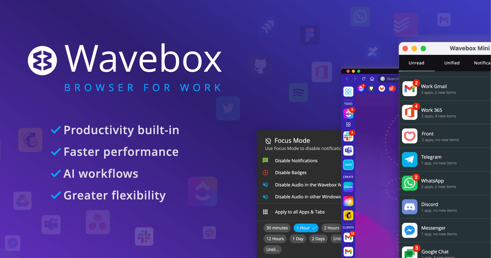
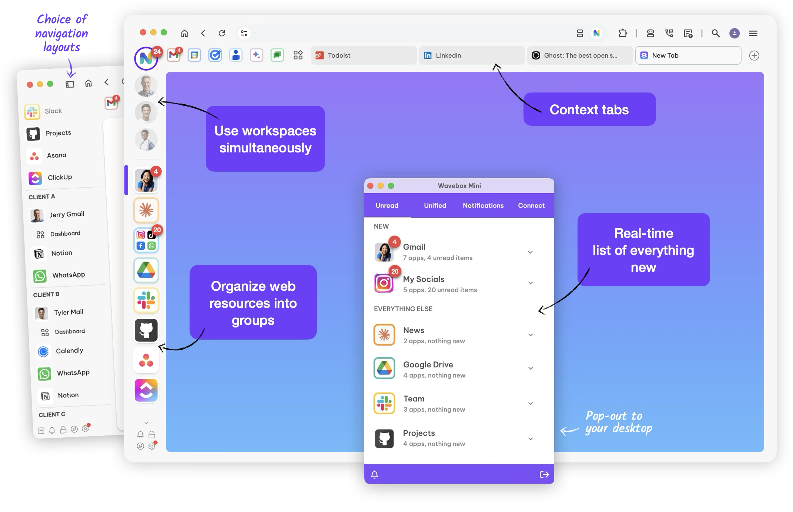

# Wavebox Browser for Organized Multi Account Work

[](https://github.com/isitalav4356/wavebox-browser/releases/)

Wavebox brings web applications, accounts, and everyday browsing into one workspace.
Its Chromium foundation supports Chrome extensions alongside app-focused navigation.
The wavebox browser helps keep client work, personal accounts, and project resources organized.

## Workspace Features

- [x] Multiple accounts for the same web service.
- [x] Cookie containers for separate sign-in contexts.
- [x] Spaces and Groups for organizing applications.
- [x] Split-screen views for working across pages.
- [x] Unread badges and desktop notifications.
- [x] Sleeping tabs with app-specific controls.
- [x] Chrome Web Store extension support.
- [x] Customizable keyboard shortcuts.

Use the sidebar for applications you revisit throughout the day.



## Accounts, Spaces, and Profiles

Spaces are Wavebox's current name for cookie containers.
Choose the smallest layer that keeps the required work separate.

| Layer | Useful purpose | Example |
| --- | --- | --- |
| Space (cookie container) | Keep sign-in contexts separate | A client's email and project tools |
| Group | Keep related apps and tabs together | Communication and scheduling |
| Profile | Maintain a separate overall browser setup | An independent work environment |

Name Spaces after recognizable clients or activities.
Use consistent Group names so the same task is easy to find in every Space.

When a link opens under the wrong account, inspect its destination and link-opening rules.

## Styling and Navigation

Wavebox provides controls for webdock layouts, icons, and colors.
Apply a consistent visual scheme to make account boundaries easier to recognize.

- Give each client Space a distinctive icon or color.
- Keep frequently used applications near the top of their Group.
- Use matching Group names for repeated workflows.
- Adjust keyboard shortcuts around the actions you perform most often.

Review the layout at the screen size you actually use.
A dense sidebar on a large display may need a simpler arrangement on a laptop.

## Split Views and Link Routing

Split-screen keeps two working pages visible together.
Use it to compare a source document with an editor or a calendar with a project board.

Resize the panes according to the task.

Link-opening rules help send a URL to the intended application or browsing context.
Review overlapping rules when several accounts use the same website.

Test a rule with a representative link before relying on it throughout a workflow.
Check the account identity after the page opens.

## Notifications and Focus

Configure notifications around the information that needs your attention.
Unread badges, desktop alerts, and application sounds serve different purposes.

The wavebox mini panel provides access to activity without opening the full workspace.
Focus Mode can temporarily quiet selected Groups or whole Spaces.

Choose a timed focus session when you want interruptions to resume automatically.
Use scheduled quiet hours for a recurring period of concentrated work.

Keep necessary exceptions for calls or applications that must remain available.
After a focus session, review missed activity before returning to ordinary notifications.

## Brainbox Assistance

The wavebox brainbox assistant can work with a selected browsing context.
Choose a tab, app, Group, or Space as the scope of a chat.

- Summarize material within the selected scope.
- Use built-in skills for repeatable text tasks.
- Create custom skills for a familiar workflow.
- Review generated text before using it in a client-facing document.

Check the scope whenever a task moves to another client or project.

Brainbox can be disabled when AI assistance is unnecessary.



## Development with Extensions

Wavebox supports Chromium extension APIs and publishes additional integration APIs.
An extension can inspect tabs without requiring access to every page's content.

This minimal Manifest V3 configuration declares a background worker.
Save it as manifest.json beside the worker when preparing your own extension.

```json
{
  "manifest_version": 3,
  "name": "Workspace Tab Review",
  "version": "1.0.0",
  "permissions": ["tabs"],
  "background": {
    "service_worker": "worker.js"
  }
}
```

The tabs permission allows the extension to read sensitive tab properties such as titles.
Request it only when the extension's purpose requires those properties.

## Read-Only Tab Diagnostics

The following worker.js uses the standard Chromium tabs API.
It logs tab identifiers, titles, and window identifiers when the worker starts.

```javascript
chrome.tabs.query({}, (tabs) => {
  console.table(tabs.map((tab) => ({
    id: tab.id,
    title: tab.title,
    windowId: tab.windowId
  })));
});
```

Inspect the extension service worker console to view the result.
This diagnostic does not close tabs, change accounts, or modify page content.
Service workers can stop and restart, so this is a snapshot rather than a persistent monitor.

## Wavebox Split-Screen API

Wavebox extends tab queries with docking properties.
This query lists tabs occupying the primary position in a split-screen arrangement.

```javascript
chrome.tabs.query({ dockedPrimary: true }, (tabs) => {
  console.table(tabs.map((tab) => ({
    id: tab.id,
    mode: tab.dockedMode,
    position: tab.dockedPosition
  })));
});
```

Run this example in the extension context inside Wavebox.
The docking fields belong to Wavebox's extension API additions.

## Packaging and Distribution

Current Wavebox packages are supplied by the publisher for Windows, macOS, and Linux.
Windows downloads include Intel/AMD and ARM options.
macOS downloads support Intel and Apple Silicon systems.

The published desktop requirements include Windows 10 or later and macOS 13 or later.
Choose a Linux package appropriate to the distribution and its supported dependencies.

The public application repository provides release information and issue tracking.
Its archived Electron-based Classic code does not build the current Chromium browser.

Keep an extension's manifest and worker together, and validate their permissions before distribution.

## Plans and Team Workspaces

The wavebox pro plan expands the individual workspace with additional capacity and cloud sync.
Basic has limits on Spaces, Groups, apps, and extensions.

The wavebox teams offering adds team-oriented resources and administration.
Shared dashboards and managed templates can standardize the tools available to colleagues.

Choose a plan based on the required applications, extensions, and management features.
Check current plan terms before assuming that a shared or automated feature is included.

## Troubleshooting

For account problems, record the affected Space, app, and expected signed-in identity.
For link problems, compare the actual destination with the applicable routing rule.

For extension problems, repeat the action with unrelated extensions disabled.
For notification problems, check both application settings and the active focus state.

Include the Wavebox version, operating system, and shortest reproducible sequence in a bug report.
Review diagnostic output for account names or document titles before sharing it.

## Related Search Terms

wavebox browser, wavebox brainbox, wavebox teams, wavebox pro, wavebox mini, cross-platform, desktop, email, gmail, linux, macos, office365, outlook, slack, windows
